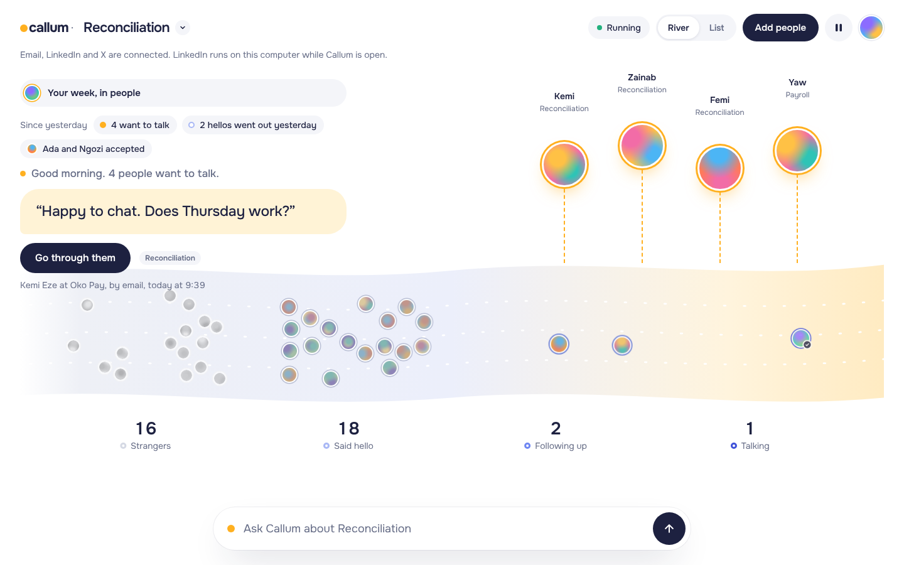
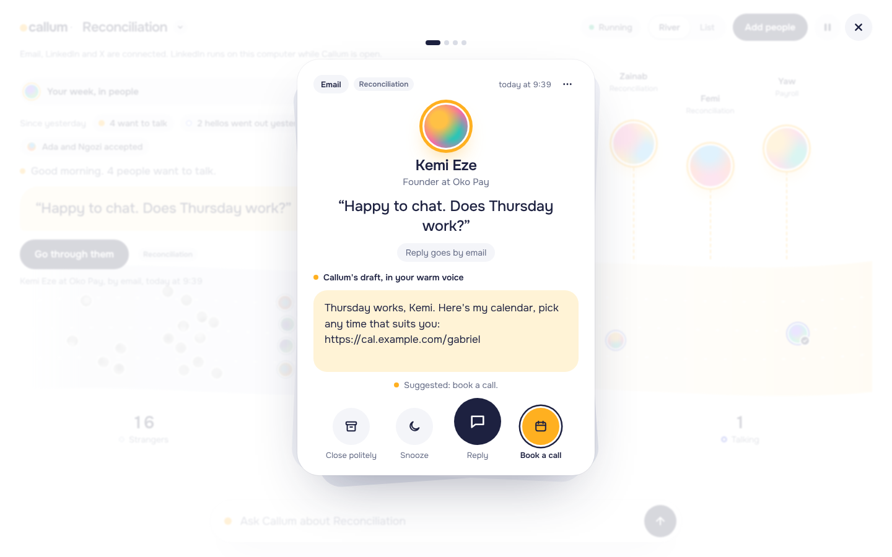

# Callum

Callum is a colleague who writes to people for you. You tell it what you offer and who you would like to meet. It sends a first hello, follows up twice, and keeps quiet when someone says no. When someone writes back, they land in one place with a reply already drafted, and you decide what to send.

It reaches people by email, LinkedIn and X, one channel per person, inside working hours in their time zone and well under each channel's daily limits. Nothing is tracked. Nothing goes to someone who asked it to stop.

Callum is open source and runs on your own computer. Your people, your messages and your channel logins stay on your machine, in one folder.





## Install

### The desktop app

This is the easiest way. Callum runs from your tray, so it keeps sending after you close the window.

1. Open the Releases page of this repository and download the file for your computer:
   - macOS: the `.dmg`
   - Windows: the `.exe` installer
   - Linux: the `.AppImage`
2. Install it and open it.
3. Follow the first run. It takes about five minutes: connect a channel, say what you offer, add a few people.

The builds are not signed yet, so your computer will warn you the first time. It is safe to continue if you downloaded the file from this repository.

- macOS: if it says Callum can't be opened, right-click the app, choose Open, then choose Open again. On recent versions of macOS you can also open System Settings, Privacy & Security, and choose Open Anyway.
- Windows: if it says Windows protected your PC, choose More info, then Run anyway.
- Linux: make the file runnable (`chmod +x Callum-*.AppImage`) and open it.

To have Callum start when your computer does, turn on "Open Callum when your computer starts" in Your Callum.

LinkedIn needs Google Chrome or Microsoft Edge installed on the same computer.

### Server mode

Run Callum on a small server and open it from any browser, including your phone. It needs Node 22.13 or newer.

```sh
git clone <this repository>
cd callum
npm install
npm run build
CALLUM_PASSWORD='choose a long password' npm start
```

Open `http://localhost:4600`. When `CALLUM_PASSWORD` is set Callum listens on every interface and asks for the password. Without it, Callum listens on this computer only.

A password sent over plain HTTP can be read by anyone on the network between you and the server. So password mode on a network needs an HTTPS reverse proxy in front of Callum (Caddy does this in a few lines: `callum.example.com { reverse_proxy localhost:4600 }`). Open Callum at the HTTPS address, and keep port 4600 closed to everyone but the proxy.

Callum locks the sign-in for a minute after five wrong passwords from one address. Behind a proxy every request arrives from the proxy's own address, so by default one person's wrong tries lock out everybody. Set `CALLUM_TRUST_PROXY=1` when Callum sits behind exactly one proxy that sets `X-Forwarded-For`, and the lockout counts the address the proxy saw instead. Leave it off otherwise: with no proxy, anyone could write that header and pick their own address.

### Docker

```sh
cp .env.example .env      # set CALLUM_PASSWORD in it
docker compose up -d
```

Open `http://localhost:4600`. To reach it from another computer, put an HTTPS reverse proxy in front of it first (see Server mode above). Your data lives in the `callum-data` volume. The image has no browser in it, so LinkedIn connects with the `li_at` cookie rather than a sign-in window. See [docs/SETUP.md](docs/SETUP.md#linkedin).

## Try it first

Demo mode fills Callum with made-up people and pretend channels, and sends nothing.

```sh
npm install
npm run build
npm run demo
```

Open `http://localhost:4600`. You start at the first run with a list of Lagos fintech founders ready to meet. To start from a morning three days in, with replies waiting and a second project, set `CALLUM_DEMO_SCENE=morning`.

## Connect your channels

You need at least one. [docs/SETUP.md](docs/SETUP.md) has every step.

| Channel | What Callum needs | Setup |
| --- | --- | --- |
| Google mail | An app password for your Google account | [Google](docs/SETUP.md#google) |
| Microsoft mail | A one-time app registration, then a sign-in code | [Microsoft](docs/SETUP.md#microsoft) |
| LinkedIn | A sign-in on this computer, or your `li_at` cookie on a server | [LinkedIn](docs/SETUP.md#linkedin) |
| X | An OAuth 2.0 user token with `dm.read dm.write tweet.read users.read offline.access` | [X](docs/SETUP.md#x) |

Two optional keys make Callum better. A Claude key lets Callum write and read in your voice, in the language people write to you in. Without it Callum uses plain templates. An Apollo key lets you describe the people you want to meet instead of bringing a list. See [Claude](docs/SETUP.md#claude) and [Apollo](docs/SETUP.md#apollo).

## Settings

Server mode reads these environment variables. The desktop app does not need any of them.

| Variable | Default | What it does |
| --- | --- | --- |
| `PORT` | `4600` | The port Callum listens on. |
| `CALLUM_DATA_DIR` | `./data` | Where the database and the saved LinkedIn session live. |
| `CALLUM_PASSWORD` | none | Asks for this password at sign-in and makes Callum listen on every interface. Required on a server. |
| `CALLUM_TRUST_PROXY` | off | Set to `1` behind one HTTPS reverse proxy that sets `X-Forwarded-For`, so the sign-in lockout counts each visitor's own address. |
| `ANTHROPIC_API_KEY` | none | Lets Claude write and read messages. |
| `CALLUM_MODEL` | `claude-opus-5-5` | The Claude model to use. |
| `APOLLO_API_KEY` | none | Lets you find people from a description. |
| `CALLUM_MICROSOFT_CLIENT_ID` | none | The client ID of your Microsoft app registration. |
| `TZ_DEFAULT` | this computer's zone | The time zone to start with, for example `Africa/Lagos`. |
| `PLAYWRIGHT_CHROMIUM_EXECUTABLE` | none | A browser for LinkedIn when Chrome and Edge are not installed. |
| `CALLUM_DEMO` | off | Set to `1` to try Callum with made-up people and no real sending. |
| `CALLUM_DEMO_SCENE` | `fresh` | In demo mode, `morning` starts three days in. |

## How Callum keeps things safe

Callum works inside these limits and does not offer a dial past them.

- Messages go out from 9:00 to 17:00, Monday to Friday, in the other person's time zone. Nothing goes out on the day you press Start.
- Email: 20 a day for the first week after you connect a mailbox, 70 a day in the second week, then 120 a day.
- LinkedIn: 15 invitations a day and 40 messages a day. After LinkedIn asks you to verify yourself, Callum goes back to 7 invitations a day for a week.
- X: 20 direct messages a day.
- Each person gets at most three messages: a hello, a follow-up 4 days later, and a last note 6 days after that. Four days after the last one, with no answer, they rest for 90 days.
- You OK the first 10 hellos of every project. After that Callum sends on its own.
- Every message you send waits 10 seconds, with Undo.
- Callum never sends text that still has a placeholder like `[YOUR PRICE]` in it.
- Callum never writes to someone who stopped, someone you closed, or someone waiting on your answer.

## Things to know before you start

### LinkedIn

Automating LinkedIn is against LinkedIn's User Agreement. If LinkedIn notices, it can limit or close your account. Callum lowers the odds: it works from your own browser session, keeps well under the numbers above, and pauses LinkedIn by itself the moment LinkedIn asks you to verify yourself or reports a limit. It cannot take the risk away. By connecting LinkedIn you accept it. If your LinkedIn account matters more to you than the extra reach, leave LinkedIn out. Email and X work without it.

### X

X charges for API access, and sending direct messages is not part of the free level. Plans and prices change, so check the current X developer pricing before you connect, and expect to pay a monthly fee or per use. The X API also limits how often you can read and send. Callum stays at 20 direct messages a day. If your X plan does not include direct messages, Callum says so when you connect.

### Rules about writing to people

- Every email ends with a line that lets people opt out: "If this isn't for you, just reply stop and I won't write again."
- A reply of stop, or anything that clearly asks you to go away, ends the conversation for good. Callum cancels what was lined up and never writes to that person again, in any project.
- Email carries a `List-Unsubscribe` header.
- Callum does not track opens or clicks, and never will.
- You are still the sender. The laws on unsolicited messages differ from country to country, and you are responsible for following the ones where you and your recipients live.

## Development

```sh
npm install
npm run dev:server      # the server in demo mode, restarting on changes
npm run dev:web         # the web app with hot reload, talking to the server on 4600
npm run typecheck
npm test
npm run e2e             # end-to-end tests in a real browser, against demo mode
```

How the code is laid out:

- `src/server/engine` holds the rules: who is next, when, on which channel. It is pure functions with no clock of its own.
- `src/server/runner` is the loop that acts on those rules every few seconds: it plans, sends through the channels, and reads what comes back.
- `src/server/channels` has one adapter per channel behind the same interface: email (SMTP and IMAP), LinkedIn (a browser), X (the API) and a demo adapter.
- `src/server/ai` writes and reads messages, with Claude or with templates.
- `src/server/leads` brings people in from a list, a LinkedIn search or Apollo.
- `src/server/db` is SQLite through `node:sqlite`.
- `src/server/api` is the small HTTP API the web app uses.
- `src/server/demo` holds the demo scenes.
- `src/web` is the React app, built with Vite.
- `electron` is the desktop shell around the same server.

## License

MIT. See [LICENSE](LICENSE).
